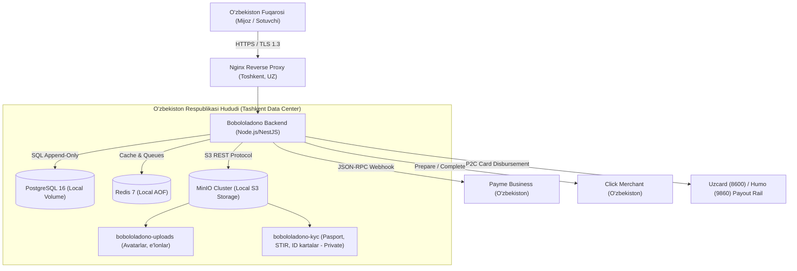

# O'zbekiston Respublikasi 547-sonli Qonuni (27¹-modda) — Shaxsiy Ma'lumotlar Suvereniteti va Muvofiqlik Hujjati

## 1. Qonuniy Asos (Legal Framework)

O'zbekiston Respublikasining 2019-yil 2-iyuldagi **O'RQ-547-son "Shaxsiy ma'lumotlar to'g'risida"gi Qonuni** va unga 2021-yil 14-yanvardagi O'RQ-666-son Qonun bilan kiritilgan **27¹-moddasi** ("O'zbekiston Respublikasi fuqarolarining shaxsiy ma'lumotlariga ishlov berishning alohida shartlari"):

> *"O'zbekiston Respublikasi fuqarolarining shaxsiy ma'lumotlariga axborot texnologiyalaridan foydalangan holda ishlov berishda, shu jumladan Internet jahon axborot tarmog'ida ishlov berishda mulkdor va (yoki) operator O'zbekiston Respublikasi fuqarolarining shaxsiy ma'lumotlari jismonan O'zbekiston Respublikasi hududida joylashgan va Shaxsiy ma'lumotlar bazalarining davlat reyestrida belgilangan tartibda ro'yxatdan o'tkazilgan shaxsiy ma'lumotlar bazalarida yig'ilishini, tizimlashtirilishini va saqlanishini ta'minlashi shart."*

Bobololadono platformasi O'zbekiston bozorida qonuniy va xavfsiz faoliyat yuritishi uchun ushbu talab to'liq dasturiy va infratuzilmaviy darajada ta'minlandi.

---

## 2. Dasturiy Himoya Qatlamlari (Technical Fail-Closed Guards)

Platforma kod bazasida xorijiy bulutlarga ma'lumot sizib chiqishini texnik jihatdan imkonsiz qiluvchi 3 ta mustaqil qatlam joriy qilingan:

### 1-qatlam: Boot-vaqtida tekshirish (`backend/src/config/env.schema.ts`)
- `DATA_RESIDENCY_COUNTRY`: default `'UZ'`. Production muhitida `'UZ'`dan boshqa qiymat bo'lsa server ishga tushmaydi (fail-closed).
- `DATA_RESIDENCY_ASSERTION`: default `'on'`.
- `S3_ENDPOINT` tekshiruvi: Agar `S3_ENDPOINT` xorijiy giper-bulutlarga (`*.amazonaws.com`, `storage.googleapis.com`, `blob.core.windows.net`, `digitaloceanspaces.com`, `backblazeb2.com`) qaragan bo'lsa, Zod `superRefine` 547-sonli qonun buzilishi bilan serverni to'xtatadi.

### 2-qatlam: Runtime Storage xizmati (`backend/src/infra/storage/storage.service.ts`)
- `StorageService` konstruktorida `assertDataSovereignty()` metodi ishga tushadi.
- KYC pasport ma'lumotlari, STIR, foydalanuvchi hujjatlari faqat Toshkentda joylashgan mahalliy MinIO/S3 klasteriga yo'naltiriladi.

### 3-qatlam: Preflight Production Audit (`backend/scripts/production-check.ts`)
- Serverni ishlab chiqarishga chiqarishdan oldin avtomatlashtirilgan `npm run production:check` skripti ishga tushiriladi va `data_sovereignty_law_547` tekshiruvidan o'tadi.

---

## 3. Infratuzilma Arxitekturasi (Uzbekistan On-Premise / Local Cloud)

Barcha ma'lumotlar Toshkent shahridagi sertifikatlangan ma'lumotlar markazlarida (masalan, Servercore Tashkent, Uztelecom Data Center yoki Uzinfocom) jismoniy serverlarda joylashtiriladi:

---

## 4. To'lov va Pul Yechish Shlyuzlari (Payment & Payout Rails)

1. **Click Merchant API (`CLICK`)**:
   - `Prepare` (action: 0) va `Complete` (action: 1) protokoli MD5 imzo tekshiruvi bilan to'liq integratsiya qilingan.
   - Endpoint: `POST /api/v1/payments/click` (hamda `/prepare`, `/complete` moslashuvchanlik yo'llari).
   - Checkout URL: `https://my.click.uz/services/pay`.

2. **Payme Merchant API (`PAYME`)**:
   - Rasmiy JSON-RPC protokoli (`CheckPerformTransaction`, `CreateTransaction`, `PerformTransaction`, `CancelTransaction`, `CheckTransaction`).
   - Basic Auth avtorizatsiya va Tiyin darajasidagi aniqlik.

3. **Payme Payout Rail (`PAYOUT_PROVIDER=PAYME`)**:
   - Sotuvchilar ishlab topgan mablag'larini to'g'ridan-to'g'ri O'zbekiston bank kartalariga (Uzcard `8600...` va Humo `9860...`) chiqaradilar.
   - Ikki tomonlama buxgalteriya balansi (`LedgerService`) orqali `FOR UPDATE` qulfi ostida to'liq atomik rezervatsiya qilinadi.

---

## 5. Davlat Ro'yxatidan O'tkazish Bosqichlari (O'zkomnazorat / DPM)

Platforma ommaviy ishga tushirilgach, quyidagi qonuniy harakatlar amalga oshiriladi:

1. **personaldata.egov.uz** portali orqali Shaxsiy ma'lumotlar bazalarining davlat reyestriga ariza topshirish.
2. Bazalar ro'yxati:
   - `bobololadono_users_db`: Foydalanuvchilar va ularning aloqa ma'lumotlari.
   - `bobololadono_kyc_db`: Mutaxassislar pasport va yuridik ma'lumotlari.
3. Shaxsiy ma'lumotlar xavfsizligiga mas'ul xodimni (Data Protection Officer) tayinlash to'g'risida ichki buyruq chiqarish.
4. Foydalanish shartlari va Maxfiylik siyosatida (Privacy Policy) foydalanuvchilarning roziligini olish tartibini tasdiqlash.
